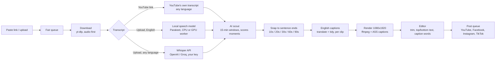
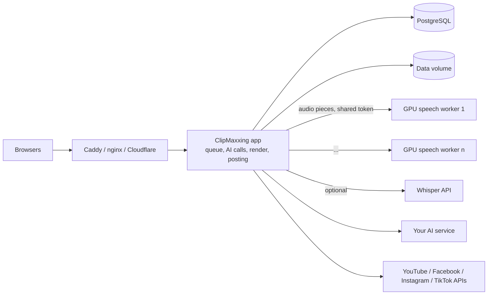

# ClipMaxxing system design

ClipMaxxing turns a long video (a YouTube link or an upload, up to hours long) into short, captioned, editable vertical
reels, and posts them to YouTube, Facebook, Instagram and TikTok. This document explains how the pieces fit, what
limits the load a server can take, and how to grow from one laptop to a fleet.

## 1. What happens to one video



| Stage | Code | Cost driver |
|---|---|---|
| Queue | `studio/jobs.py` `_FairQueue` | none: one line per user, served in turns, quick re-makes jump ahead |
| Download | `studio/media.py` | network; audio comes first so work starts before the video finishes |
| Transcript | `studio/transcribe.py`, `studio/speech.py`, `studio/asr_worker.py` | CPU/GPU minutes, or Whisper API minutes |
| Finding moments | `studio/brain.py` `find_clips` | AI tokens: one call per 15-minute window |
| Captions | `studio/brain.py` `english_captions` | AI tokens: one small call per clip |
| Render | `studio/render.py` | CPU: one ffmpeg encode per clip (Intel QSV used when present) |
| Posting | `studio/posting.py`, `studio/accounts.py` | network; spacing and daily caps per creator |

Long videos (over 40 minutes) are handled in **scan mode**: loudness is measured for every second, only the lively
regions are transcribed (or YouTube's transcript is read for all of it), and the best clips of the whole video
are picked at once. Only the pieces that become clips are downloaded in full quality.

### Finding the best moments

The AI reads the timestamped transcript in 15-minute windows (with 1 minute of overlap), with lines marked
`(LOUD)` where the audio jumps. It returns distinct moments (opinion, surprising fact, tip, emotional,
funny, story with a payoff...), each with a score, a hook (top text), a subtext (bottom text), a title,
description and hashtags. Each moment is then snapped so it starts on a line and ends on the end of a sentence,
inside the chosen reel length. Overlapping picks are dropped in favour of the higher score. With no AI key, the
loudest stretches with speech are used.

### English-only captions

Setting: **Settings, AI, Speech and captions** (`CLIPMAXXING_CAPTION_LANGUAGE=english`, the default).

1. English speech: the words as said, tidied (numbers as digits, names, punctuation).
2. Any other language, Hindi included: YouTube's English captions for that span if YouTube has them, otherwise the
   AI translates line by line and each English line is laid over the time its original line was spoken.
3. Hook, subtext, title, description and hashtags are written in English.
4. Last safety net: nothing is ever drawn in a script the caption fonts can't show.

The local speech model understands English only. For uploads in other languages, choose Whisper (OpenAI or Groq)
in the same settings page. YouTube links don't need it: YouTube's own transcript is used.

## 2. The reel layout

The **Headline** layout (default) is a clean 1080x1920 frame:

```
 ┌──────────────────────┐ 0
 │                      │
 │   TOP TEXT (HOOK),   │  ~360  big white, up to 3 lines, auto-shrinks
 │   UP TO 3 LINES      │
 ├──────────────────────┤ 560
 │                      │
 │      THE VIDEO       │  1080x700 box: wide video fills it, tall video is centred
 │                      │
 ├──────────────────────┤ 1260
 │   word-by-word       │  ~1385 captions (Bounce, Hype or Clean style)
 │   captions           │
 │   bottom text        │  ~1575 lime, up to 2 lines
 │                      │
 └──────────────────────┘ 1920   (bottom ~300 px left clear for the platforms' own buttons)
```

Everything on screen is editable per clip in the editor: top text, bottom text, caption style (9 animated styles),
caption position, layout, start and end, every caption line's words, and **cuts**: parts removed from the middle of
a clip (marked on the playhead, a whole caption line, or every long pause). Cut parts are dropped with ffmpeg
`trim`/`concat` before the layout step, and captions are shifted to match (`render.clean_cuts`, `kept_parts`). Saving
re-renders only that clip, through the quick lane of the queue.

## 3. Where state lives

| What | Where | Notes |
|---|---|---|
| Users, sessions, usage, posts | Database: SQLite on a laptop, PostgreSQL on a server (`DATABASE_URL`) | |
| Videos, clips, transcripts | Data folder: `data/users/<user>/jobs/<job>/` | `words.json`, `clips/*.mp4`, `job.json` |
| AI key, speech key | `data/ai.json`, `data/speech.json` (mode 600) | never sent back to the browser |
| Platform apps (Google, Meta, TikTok) | `data/apps.json` or `.env` | one app per server, not per user |
| Connected accounts and tokens | `data/users/<user>/accounts/accounts.json` (mode 600) | Facebook: one account per Page |

## 4. What limits a server

A server is protected by measuring, not by counting people (`studio/load.py`): a new video starts only while the
processor is under `CLIPMAXXING_BUSY_CPU` (82%) and there is free memory and disk; otherwise it waits in the fair queue
and starts the moment the machine has room. Re-making one clip is never held back.

Rough cost of one 1-hour video, to size a server (measure your own: the dashboard shows times per video):

- **Transcript.** YouTube link with a transcript: seconds. Local model on CPU: the dominant cost; a GPU worker
  (`asr_worker.py`) is many times faster and shared by every app server. Whisper API: no local CPU, billed per minute.
- **AI.** About 4 window calls plus one small call per clip. Tokens are recorded on the AI usage page.
- **Render.** One encode per clip (6 clips by default), about as long as the clip or less at 720p on a modern CPU.
- **Disk.** The source video at 720p plus a few MB per clip. Set `CLIPMAXXING_MAX_USER_GB` on a shared server.

Knobs (all in `.env.example`): `CLIPMAXXING_JOB_WORKERS`, `CLIPMAXXING_MAX_JOBS_PER_USER`, `CLIPMAXXING_MAX_VIDEO_HOURS`,
`CLIPMAXXING_MAX_UPLOAD_MB`, `CLIPMAXXING_MAX_USER_GB`, `CLIPMAXXING_BUSY_CPU`, `CLIPMAXXING_MIN_FREE_RAM_GB`, `CLIPMAXXING_ASR_URL`.

## 5. Growing

### Stage 1: one machine (works today)

`python -m studio.server` or `docker compose up -d`. App + SQLite or PostgreSQL + Caddy for HTTPS. Good for one
agency and its creators.

### Stage 2: app server + speech machines (works today)



Speech is the heaviest step, so it moves first: run `python -m studio.asr_worker` on a GPU machine (see
`deploy/gpu/`) and set `CLIPMAXXING_ASR_URL` and `CLIPMAXXING_ASR_TOKEN` on the app. If the worker is away, the app falls back
to its own model for those pieces. Or skip GPUs and choose Whisper in the dashboard. Rendering stays on the app
server; give it more cores and raise `CLIPMAXXING_JOB_WORKERS`.

### Stage 3: many app servers (roadmap, needs code changes)

Today the queue and the job state live in one app process plus its data folder, so you cannot simply run two app
servers behind one load balancer. To scale out horizontally:

1. **Queue to Redis** (or PostgreSQL `SELECT ... FOR UPDATE SKIP LOCKED`): `_FairQueue.put/get` become shared,
   keeping the one-line-per-user fairness. Add a heartbeat per running job so a crashed worker's job is picked up
   again (the restart code in `_pick_up_after_restart` already resumes from the last finished part).
2. **Files to object storage** (S3, R2): sources and clips are written to a bucket; `/media/...` becomes a signed
   redirect. This also gives Instagram and Facebook a public URL to fetch from.
3. **Split roles**: web servers (stateless, any number) and render workers (pull from the queue, CPU-heavy,
   autoscale on queue length). Speech workers already exist as their own role.
4. **Sync channel**: `/api/sync` counters (`ctx.bump`) move to Redis pub/sub so any web server can answer.

The code is already shaped for this: every request knows its user (`ctx.uid()`), every write to a job goes through
`jobs.save`, and every external service (AI, speech, platforms) is behind one module.

## 6. Security and keys

- Keys are pasted in the dashboard, saved on the server only (file mode 600), and shown back only as their last 4
  characters. They can also come from `.env` or `*_FILE` secrets.
- Text from videos is untrusted: it goes into prompts escaped, and what the AI writes is stripped of links,
  @handles and control characters before it reaches a caption or a post.
- Posting tokens are per user and per Page/channel; disconnecting removes them.
- Facebook needs a Meta app with Facebook Login for Business and the permissions `pages_show_list`,
  `pages_read_engagement`, `pages_manage_posts`. YouTube needs a Google OAuth client with YouTube Data API v3.
  Both require app review by the platform before people outside your team can connect.
